**DATA & AI DEVELOPER**

# 최이재 | Jenny Choi

### 🗂 [Projects](#-projects) · 📚 [Study](#-study) · 🧩 [Mini Projects](#mini-projects)

---

## 👋 About Me

환경공학을 전공하고 환경분석 업무를 하며 반복되는 분석 작업을 데이터와 AI로 효율화하는 일에 관심을 갖게 되었습니다. 
지금은 **한국폴리텍대학 인공지능소프트웨어과**에서 그 방법을 직접 배우고 만들어 가고 있습니다.

## 🛠 Tech Stack

<table width="100%">
<tr>
<td><b>Languages</b></td>
<td>      </td>
</tr>
<tr>
<td><b>AI & ML</b></td>
<td>       </td>
</tr>
<tr>
<td><b>Data</b></td>
<td>     </td>
</tr>
<tr>
<td><b>Collection</b></td>
<td> </td>
</tr>
<tr>
<td><b>Backend</b></td>
<td>  </td>
</tr>
<tr>
<td><b>Frontend & App</b></td>
<td>    </td>
</tr>
<tr>
<td><b>Databases</b></td>
<td>    </td>
</tr>
<tr>
<td><b>Deployment</b></td>
<td>       </td>
</tr>
<tr>
<td><b>Tools</b></td>
<td>      </td>
</tr>
</table>

---

## 🗂 Projects

<table width="100%">
<tr>
<td width="40%" valign="top">

 
<a href="https://github.com/Jenny5789/CGI_MOA">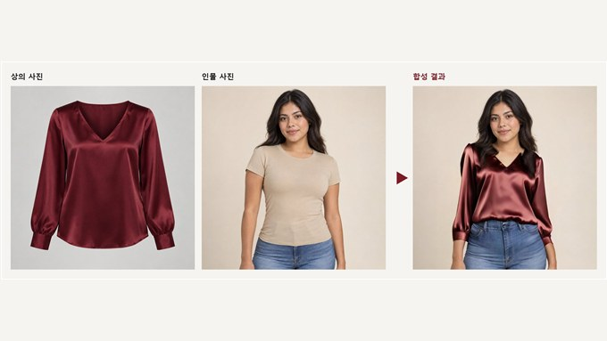</a>

`Image Generation` 
`2026.10 · 4인 팀 (팀장)`
</td>
<td width="60%" valign="top">

## [MOA](https://github.com/Jenny5789/CGI_MOA) 
`SAM2` `AnyDoor` `PyTorch` `FastAPI` `React` 
**생성형 AI 기반 서비스 개발 · AI 모델 서빙 및 백엔드 구축**

- 가상 피팅 웹 서비스 (상의 착용 미리보기)
- SAM2 상의 분할 → AnyDoor 착용 합성
- 백엔드–AI 연동, 비동기 작업 큐, 토큰 인증

</td>
</tr>
</table>

<table width="100%">
<tr>
<td width="40%" valign="top">

 
<a href="https://github.com/Jenny5789/SPORTORY">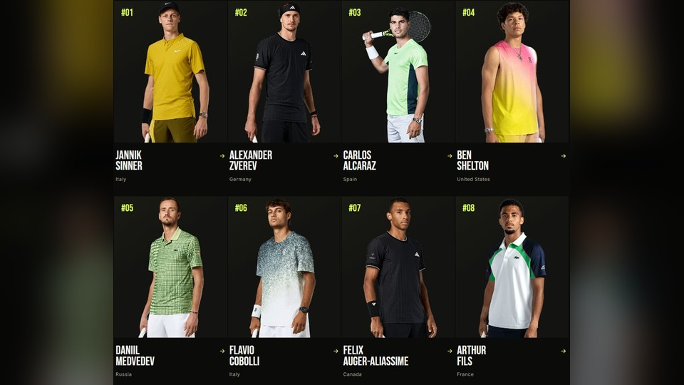</a>

`Data Pipeline · Full-stack` 
`2026.09`
</td>
<td width="60%" valign="top">

## [SPORTORY](https://github.com/Jenny5789/SPORTORY) 
`Selenium` `FastAPI` `React` `PostgreSQL` 
**데이터 수집 파이프라인 구축 · 웹 서비스 개발 및 배포**

- ATP 선수 기록 · Biography 통합 서비스
- CDP 기반 API 응답 수집, Raw 보존 · 정제 · UPSERT
- Gemini 번역, 수집 스케줄링, Vercel · Render 배포

</td>
</tr>
</table>

<table width="100%">
<tr>
<td width="40%" valign="top">

 
<a href="https://github.com/Jenny5789/hyrox-analysis">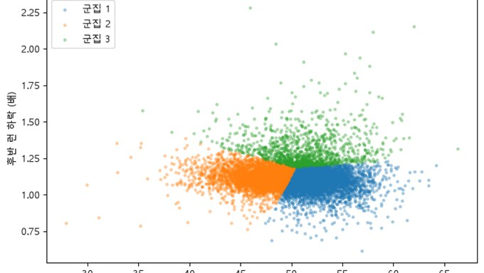</a>

`Machine Learning` 
`2026.10`
</td>
<td width="60%" valign="top">

## [HYROX 기록 분석](https://github.com/Jenny5789/hyrox-analysis) 
`Pandas` `scikit-learn` `Matplotlib` 
**정형 데이터 분석 · 머신러닝 모델링 및 검증**

- 대회 기록 9만 건 정형 데이터 ML 분석
- K-Means 페이스 군집, 후반 기록 회귀 · 완주 등급 분류
- 시즌 단위 분할, 데이터 누수 점검, 기준선 대비 검증

</td>
</tr>
</table>

<table width="100%">
<tr>
<td width="40%" valign="top">

 
<a href="https://github.com/Jenny5789/cnn-crop-classifier">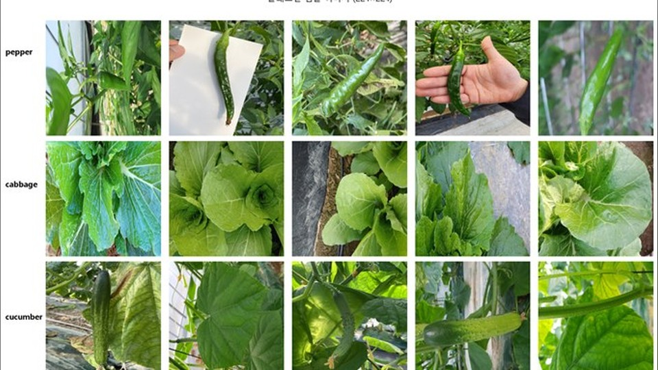</a>

`Deep Learning` 
`2026.09`
</td>
<td width="60%" valign="top">

## [작물 이미지 분류](https://github.com/Jenny5789/cnn-crop-classifier) 
`PyTorch` `torchvision` `Docker` 
**딥러닝 모델 구현 · 학습 및 성능 개선**

- 작물 3종(고추·배추·오이) 분류 CNN 설계
- 언더샘플링, 정규화, 데이터 증강, Early Stopping
- Conv 블록 깊이 비교 실험, Test Acc 97.2%

</td>
</tr>
</table>

<table width="100%">
<tr>
<td width="40%" valign="top">

 
<a href="https://github.com/Jenny5789/CourtVision">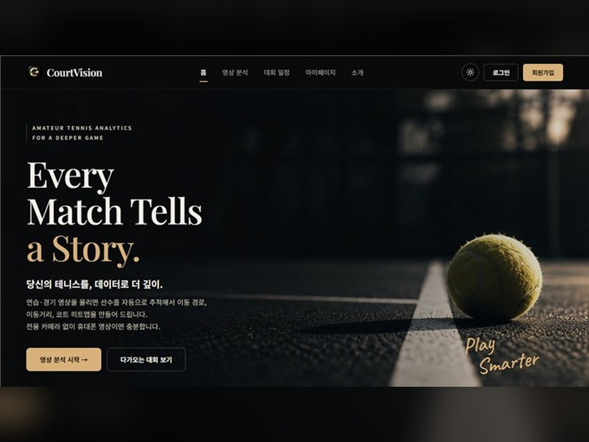</a>

`Computer Vision` 
`2026.09`
</td>
<td width="60%" valign="top">

## [CourtVision](https://github.com/Jenny5789/CourtVision) 
`YOLO11` `OpenCV` `OpenVINO` `FastAPI` 
**컴퓨터 비전 기반 영상 분석 · 모델 경량화**

- 테니스 영상 선수 추적 (YOLO11n · BoT-SORT)
- Homography 코트 좌표 변환, 이동거리 · 속도 · 히트맵
- INT8 양자화 (모델 68%↓ · 추론 1.7×), 대회 일정 크롤링

</td>
</tr>
</table>

<table width="100%">
<tr>
<td width="40%" valign="top">

 
<a href="https://github.com/Jenny5789/illegal-parking-detection">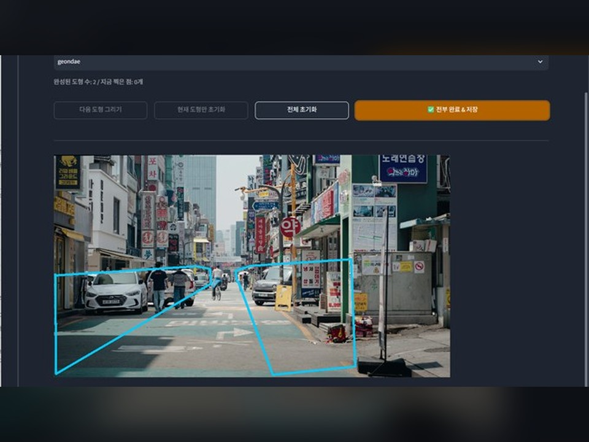</a>

`Object Tracking` 
`2026.08`
</td>
<td width="60%" valign="top">

## [CCTV 불법주정차 탐지](https://github.com/Jenny5789/illegal-parking-detection) 
`YOLOv8` `DeepSORT` `Streamlit` 
**컴퓨터 비전 기반 객체 탐지·추적 서비스 개발**

- CCTV 불법주정차 자동 탐지 웹 앱
- YOLOv8 탐지 + DeepSORT 추적, ROI 기반 정차 판정
- 가림 · 카메라 흔들림 · ID 스위칭 예외 로그 진단 · 개선

</td>
</tr>
</table>

<table width="100%">
<tr>
<td width="40%" valign="top">

 
<a href="https://github.com/Jenny5789/hangang-water-quality">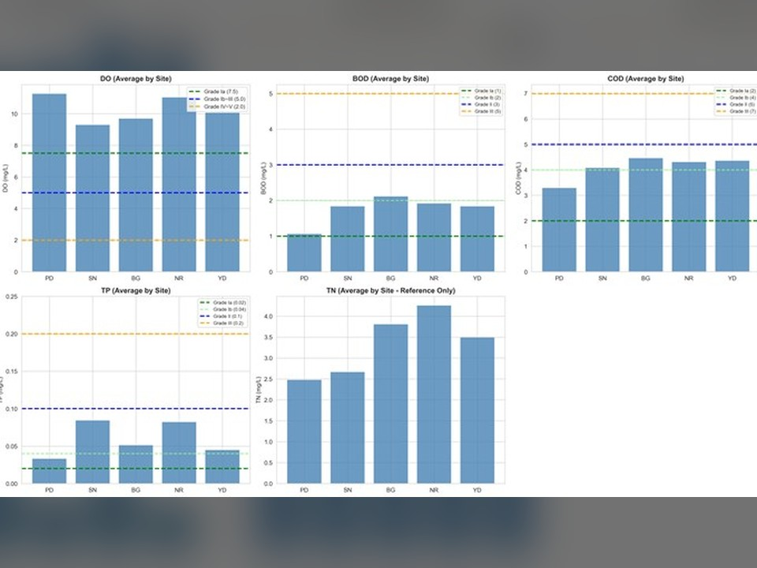</a>

`Data Analysis` 
`2026.06`
</td>
<td width="60%" valign="top">

## [한강 수질 분석](https://github.com/Jenny5789/hangang-water-quality) 
`Pandas` `Plotly` `Streamlit` 
**공공 데이터 탐색적 분석 · 시각화 대시보드 구현**

- 한강 5개 측정소 36개월 수질 EDA · 시계열 분석
- 수질 등급(Ⅰ~Ⅴ) 기준 지점별 · 계절별 비교
- 하류 영양염(TN · TP) 누적, 지류(성내천) 최고 오염도 도출

</td>
</tr>
</table>

<table width="100%">
<tr>
<td width="40%" valign="top">

 
<a href="https://github.com/Jenny5789/web/tree/main/korea_travel">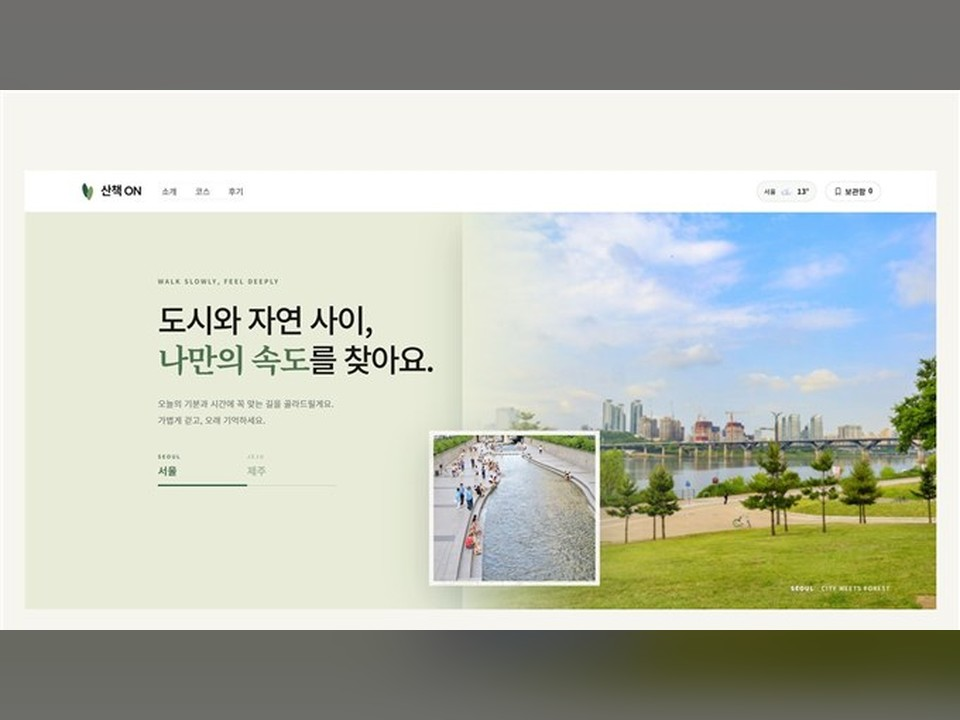</a>

`Web · Open API` 
`2026.06 · 3인 팀`
</td>
<td width="60%" valign="top">

## [산책 ON](https://github.com/Jenny5789/web/tree/main/korea_travel) 
`JavaScript` `Kakao Map API` `기상청 API` 
**Open API 연동 웹 서비스 개발**

- 서울 · 제주 산책 코스 · 맛집 조건별 추천
- 기상청 단기 · 중기예보 통합 7일 예보
- 카카오맵 경로 표시, 거리 · 소요 시간 계산, 리뷰

</td>
</tr>
</table>

---

## 📚 Study

수업과 교재로 배운 이론을 과목별로 정리하고 실습한 기록입니다.

| 과목 | 내용 |
|---|---|
| &nbsp;&nbsp;&nbsp;**[Python](https://github.com/Jenny5789/python)** | 이론 노트 · 자료구조 구현 · Flet GUI 앱 · 코딩테스트 |
| &nbsp;&nbsp;&nbsp;**[Data Analysis](https://github.com/Jenny5789/Data_Analysis_Study)** | NumPy · Pandas 공식 문서 기반 실습 |
| &nbsp;&nbsp;&nbsp;**[Deep Learning](https://github.com/Jenny5789/DL_project)** | 딥러닝 · 머신러닝 이론 · Flask · Docker 실습 |
| &nbsp;&nbsp;&nbsp;**[Computer Vision](https://github.com/Jenny5789/computer-vision-basics)** | OpenCV 특징점 매칭 · 객체 인식 |
| &nbsp;&nbsp;&nbsp;**[Web](https://github.com/Jenny5789/web)** | HTML · CSS · JavaScript 실습 |
| &nbsp;&nbsp;&nbsp;**[Java](https://github.com/Jenny5789/java)** | 기초 문법 · 클래스와 객체 · 서블릿 |
| &nbsp;&nbsp;&nbsp;**[C++](https://github.com/Jenny5789/cpp-study)** | C++ 기초 문법 · 연습문제 |
| &nbsp;&nbsp;&nbsp;**[Linux](https://github.com/Jenny5789/Total-TIL/tree/main/Linux)** | Linux 기본 명령어 · VI 에디터 실습 |

---

 

<b>🧩 Mini Projects</b>

 

<table width="100%">
<tr>
<td width="47%" valign="top">

<a href="https://github.com/Jenny5789/student_manager">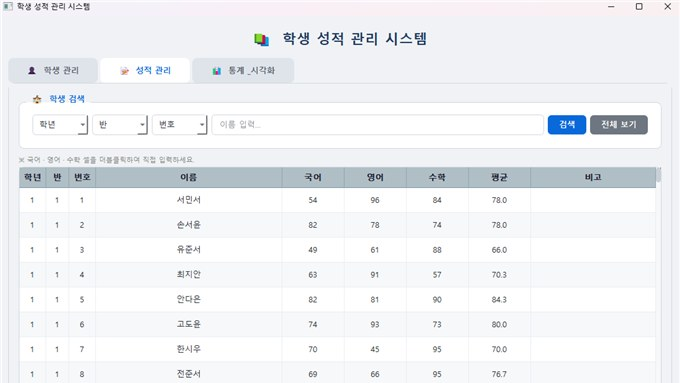</a>

## [Student Manager](https://github.com/Jenny5789/student_manager)

`PyQt5` `SQLite`

- 학생 · 성적 관리 데스크톱 앱
- 성적 일괄 저장 트랜잭션 · 롤백

</td>
<td width="6%" valign="top" align="center"></td>
<td width="47%" valign="top">

<a href="https://github.com/Jenny5789/todo_list">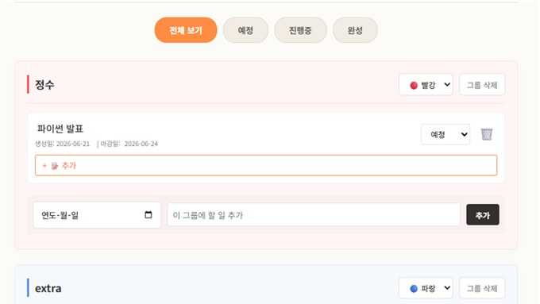</a>

## [To-Do List](https://github.com/Jenny5789/todo_list)

`JavaScript` `localStorage`

- 그룹형 할 일 · 메모 관리 웹 앱
- localStorage 영속화, 상태 필터

</td>
</tr>
</table>

---

<table width="100%">
<tr>
<td width="47%" valign="top">

<a href="https://github.com/Jenny5789/card_quiz">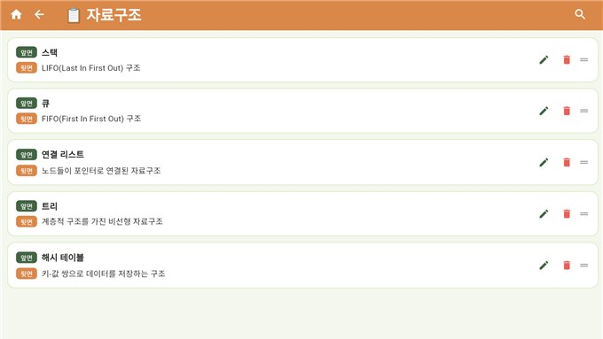</a>

## [Card Quiz](https://github.com/Jenny5789/card_quiz)

`Flutter` `Dart`

- 플래시카드 단어장 학습 앱
- 줄 편집기 CRUD 응용, 오답 복습

</td>
<td width="6%" valign="top" align="center"></td>
<td width="47%" valign="top">

<a href="https://github.com/Jenny5789/DFS-algorithm-maze">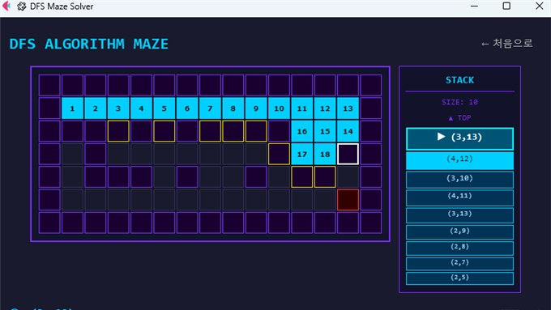</a>

## [DFS Maze](https://github.com/Jenny5789/DFS-algorithm-maze)

`Python` `Flet`

- 스택 ADT 직접 구현
- DFS 탐색 단계별 시각화

</td>
</tr>
</table>

---

<table width="100%">
<tr>
<td width="47%" valign="top">

<a href="https://github.com/Jenny5789/engineering_calculator">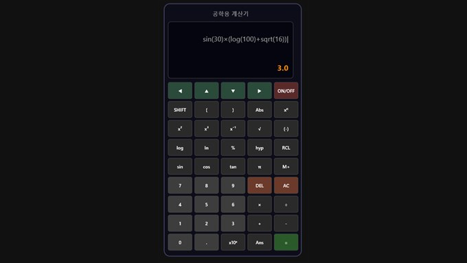</a>

## [Engineering Calculator](https://github.com/Jenny5789/engineering_calculator)

`Python` `Flet`

- 공학용 계산기
- 수식 전처리, 허용 함수 제한 eval

</td>
<td width="6%" valign="top" align="center"></td>
<td width="47%" valign="top">

<a href="https://github.com/Jenny5789/Data_Analysis_Study/tree/main/pandas/korea_air_quality_analysis">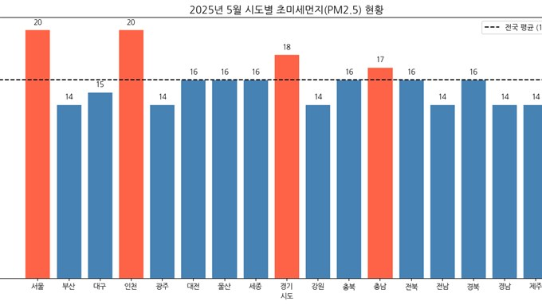</a>

## [대기오염 분석](https://github.com/Jenny5789/Data_Analysis_Study/tree/main/pandas/korea_air_quality_analysis)

`pandas` `matplotlib`

- 에어코리아 시도별 PM2.5 비교
- 엑셀 데이터 정제, 전국 평균 대비 시각화

</td>
</tr>
</table>

