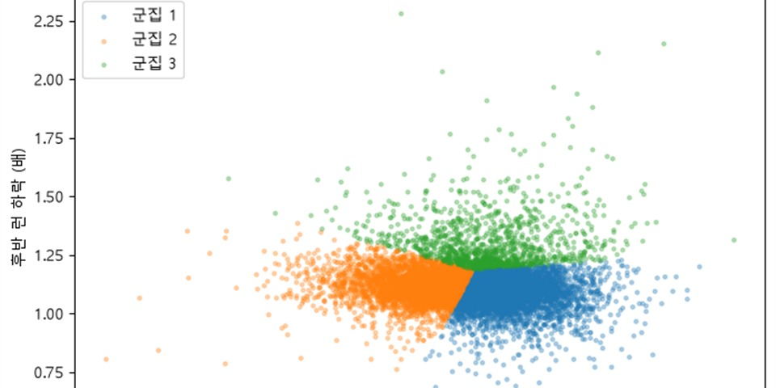
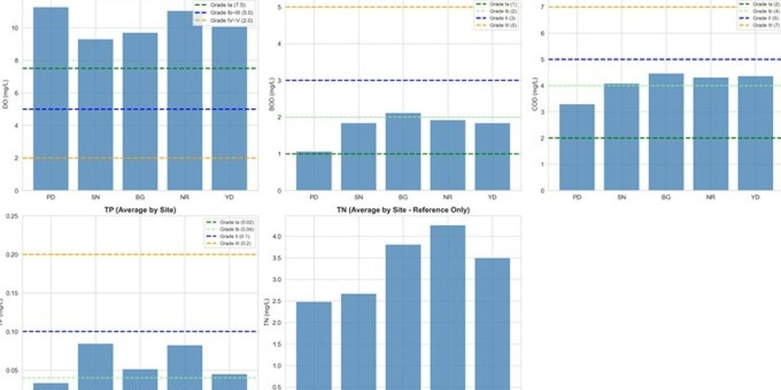
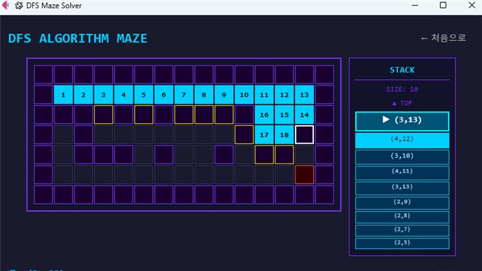
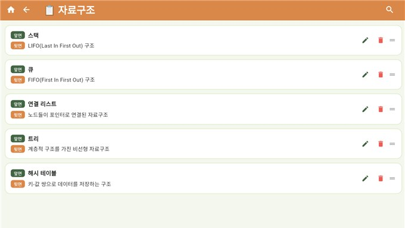
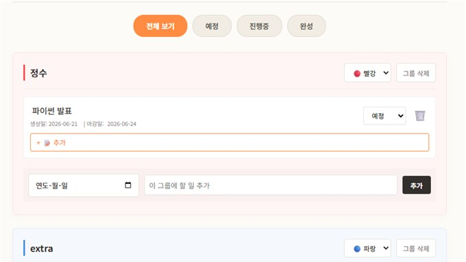

<h1>최이재 | 데이터·AI 개발자</h1>

<h4><a href="#-projects">🗂 Projects</a> · <a href="#-mini-projects">🧩 Mini Projects</a> · <a href="#-study">📚 Study</a></h4>

---

## 🛠 Tech Stack

<table width="100%">
<tr><td colspan="2"></td></tr>
<tr>
<td width="50%" valign="top"><b>Languages</b> &nbsp; &nbsp; &nbsp; &nbsp; &nbsp; &nbsp; &nbsp; </td>
<td width="50%" valign="top"><b>AI &amp; ML</b> &nbsp; &nbsp; &nbsp; &nbsp; &nbsp; &nbsp; &nbsp; </td>
</tr>
<tr>
<td width="50%" valign="top"><b>Data</b> &nbsp; &nbsp; &nbsp; &nbsp; &nbsp; &nbsp; &nbsp; </td>
<td width="50%" valign="top"><b>Backend &amp; DB</b> &nbsp; &nbsp; &nbsp; &nbsp; &nbsp; &nbsp; &nbsp; &nbsp; &nbsp; &nbsp; &nbsp; </td>
</tr>
<tr>
<td width="50%" valign="top"><b>Frontend &amp; App</b> &nbsp; &nbsp; &nbsp; &nbsp; </td>
<td width="50%" valign="top"><b>Deployment</b> &nbsp; &nbsp; </td>
</tr>
<tr>
<td colspan="2" valign="top"><b>Tools</b> &nbsp; &nbsp; &nbsp; &nbsp; &nbsp; &nbsp; &nbsp; &nbsp; &nbsp; &nbsp; &nbsp; </td>
</tr>
</table>

---

## 🗂 Projects

<table width="100%">
<tr>
<td width="49%" valign="top">

**[CGI_MOA](https://github.com/Jenny5789/CGI_MOA)** &nbsp;Image Generation · 2026.09 ~ 2026.11 (8주) · 4인 팀 (팀장)

`SAM2` `AnyDoor` `PyTorch` `FastAPI` `React` 

**사용자 제공 배경과 객체의 합성 이미지 생성 구현 (생성형 AI · 모델 서빙)**

- 상의 착용 모습을 미리 보여 주는 가상 피팅 웹 서비스
- 사진 두 장 입력 → 영역 지정(SAM2) → 합성(AnyDoor) → 원본 복원
- 담당: 총괄 · 백엔드 · DB 설계 · 이미지 처리 파이프라인

</td>
<td width="2%"></td>
<td width="49%" valign="top">

**[SPORTORY](https://github.com/Jenny5789/SPORTORY)** &nbsp;Data Pipeline · Full-stack · 2026.09

`Selenium` `PostgreSQL` `FastAPI` `React` `Gemini` 

**웹 데이터 수집 · 정제 파이프라인과 웹 서비스 구현 · 배포**

- ATP 선수 기록과 Biography를 제공하는 웹 서비스
- 브라우저 자동화로 수집, 정제 후 DB에 저장, 정기 자동 실행
- 원문이 바뀐 Biography만 Gemini로 영한 번역

</td>
</tr>
<tr><td colspan="3">&nbsp;</td></tr>
<tr>
<td width="49%" valign="top">

**[HYROX 기록 분석](https://github.com/Jenny5789/hyrox-analysis)** &nbsp;Machine Learning · 2026.10

`Pandas` `scikit-learn` `Matplotlib` 

**정형 데이터 분석과 머신러닝 모델링 · 검증**

- 대회 기록 9만 건 전처리와 탐색적 분석
- K-Means 군집, 후반 기록 회귀, 완주 등급 분류
- 시즌 단위 분할, 데이터 누수 점검, 기준선 대비 검증

</td>
<td width="2%"></td>
<td width="49%" valign="top">

**[작물 이미지 분류](https://github.com/Jenny5789/cnn-crop-classifier)** &nbsp;Deep Learning · 2026.09

`PyTorch` `torchvision` `Docker` 

**이미지 분류 딥러닝 모델 구현**

- 작물 3종(고추·배추·오이)을 분류하는 CNN 구현
- 언더샘플링, 정규화, 증강, Early Stopping 적용
- Conv 블록 깊이를 바꿔 비교한 실험

</td>
</tr>
<tr><td colspan="3">&nbsp;</td></tr>
</table>

<b>More Projects</b>

 

<table width="100%">
<tr>
<td width="49%" valign="top">

**[CourtVision](https://github.com/Jenny5789/CourtVision)** &nbsp;Computer Vision · 2026.09

`YOLO11` `OpenCV` `OpenVINO` `FastAPI` 

**영상 기반 객체 추적 · 분석과 모델 경량화 구현 (컴퓨터 비전)**

- 테니스 경기 영상 선수 추적 (YOLO11n, BoT-SORT)
- 영상 좌표를 코트 위치로 바꿔 이동거리 · 속도 · 히트맵 산출
- INT8 양자화로 모델 경량화

</td>
<td width="2%"></td>
<td width="49%" valign="top">

**[CCTV 불법주정차 탐지](https://github.com/Jenny5789/illegal-parking-detection)** &nbsp;Object Tracking · 2026.08

`YOLOv8` `DeepSORT` `Streamlit` 

**영상 객체 탐지 · 추적 서비스 구현 (컴퓨터 비전)**

- CCTV 영상에서 불법주정차를 자동 탐지하는 웹 앱
- 차량 탐지 · 추적 후 지정 구역(ROI)에서 정차 판정
- 가림, 카메라 흔들림 등 예외 상황을 로그로 진단 · 개선

</td>
</tr>
<tr><td colspan="3">&nbsp;</td></tr>
<tr>
<td width="49%" valign="top">

**[한강 수질 분석](https://github.com/Jenny5789/hangang-water-quality)** &nbsp;Data Analysis · 2026.06

`Pandas` `Plotly` `Streamlit` 

**공공 데이터 분석과 시각화 대시보드 구현**

- 한강 5개 측정소 36개월 수질 EDA · 시계열 분석
- 수질 등급 기준으로 지점별 · 계절별 비교
- 하류에 영양염(TN · TP) 누적 확인

</td>
<td width="2%"></td>
<td width="49%" valign="top">

**[산책 ON](https://github.com/Jenny5789/web/tree/main/korea_travel)** &nbsp;Web · Open API · 2026.06 · 3인 팀

`JavaScript` `Kakao Map API` `기상청 API` 

**Open API 연동 웹 서비스 구현**

- 서울 · 제주 산책 코스와 맛집을 조건별로 추천
- 기상청 단기 · 중기예보를 합친 7일 예보
- 카카오맵 경로 표시, 거리 · 소요 시간 계산

</td>
</tr>
</table>

---

## 🧩 Mini Projects

<table width="100%">
<tr>
<td width="33%" valign="top">

**[Student Manager](https://github.com/Jenny5789/student_manager)** &nbsp;2026.06

`PyQt5` `SQLite` 

**DB 연동 데스크톱 앱 구현**

- 학생 · 성적을 관리하는 데스크톱 앱
- 성적 일괄 저장을 트랜잭션으로 처리, 롤백

</td>
<td width="33%" valign="top">

**[Iris KNN 품종 분류](https://github.com/Jenny5789/DL_project/tree/main/flask/iris_knn_flask)** &nbsp;2026.10

`scikit-learn` `Flask` `Docker`

**머신러닝 분류 모델 웹 서비스 구현**

- 붓꽃 측정값 4개로 품종 3종을 분류하는 KNN 웹 앱
- 입력값으로 예측하고 품종별 이미지 출력

</td>
<td width="33%" valign="top">

**[MNIST 손글씨 숫자 인식](https://github.com/Jenny5789/DL_project/tree/main/tensorflow/MNIST)** &nbsp;2026.10

`TensorFlow` `Keras` `Flask`

**딥러닝 이미지 인식 웹 서비스 구현**

- 캔버스에 그린 손글씨 숫자를 인식하는 CNN 웹 앱
- MNIST 6만 장 학습, Conv 2층 + Dense 구조
- 입력을 28×28로 전처리한 뒤 숫자 · 확률 출력

</td>
</tr>
</table>

<b>More Mini Projects</b>

 

<table width="100%">
<tr>
<td width="33%" valign="top">

**[Flet Projects](https://github.com/Jenny5789/python/tree/main/flet_projects)** &nbsp;2026.03

`Python` `Flet` `SQLite`

**데스크톱 앱 구현**

- Flet으로 만든 데스크톱 앱 6종
- UP-DOWN, 가위바위보, 연락처, 계산기, 볼링, POS
- 이벤트 → 상태 관리 → 클래스 → DB 연동 순으로 학습

</td>
<td width="33%" valign="top">

**[AI Photo Studio](https://github.com/Jenny5789/photo-ai)** &nbsp;2026.05

`Flask` `Replicate API` `Render`

**AI 이미지 변환 웹 서비스 구현 (생성형 AI API 연동)**

- 얼굴 사진을 12가지 테마의 AI 이미지로 변환하는 웹 서비스
- 외부 AI API(PhotoMaker) 호출, 생성 완료까지 상태 확인
- Render에 배포해 운영

</td>
<td width="33%" valign="top">

**[대기오염 분석](https://github.com/Jenny5789/Data_Analysis_Study/tree/main/pandas/korea_air_quality_analysis)** &nbsp;2026.06

`pandas` `matplotlib` 

**공공 데이터 비교 분석과 시각화**

- 에어코리아 시도별 PM2.5 비교
- 엑셀 데이터 정제, 전국 평균 대비 시각화

</td>
</tr>
<tr><td colspan="3">&nbsp;</td></tr>
<tr>
<td width="33%" valign="top">

**[Engineering Calculator](https://github.com/Jenny5789/engineering_calculator)** &nbsp;2026.06

`Python` `Flet` 

**Python 기본기를 활용한 GUI 계산기 구현**

- Flet GUI 공학용 계산기
- 정규식으로 수식 전처리, 허용한 함수만 계산

</td>
<td width="33%" valign="top">

**[DFS Maze](https://github.com/Jenny5789/DFS-algorithm-maze)** &nbsp;2026.06

`Python` `Flet` 

**자료구조 · 알고리즘 구현과 시각화**

- DFS로 미로 탐색 경로를 단계별로 시각화
- 스택 자료구조 구현

</td>
<td width="33%" valign="top">

**[Card Quiz](https://github.com/Jenny5789/card_quiz)** &nbsp;2026.06

`Flutter` `Dart` 

**모바일 학습 앱 구현**

- 단어장을 플래시카드로 학습하는 Flutter 앱
- Provider 상태관리, CRUD, 오답 복습

</td>
</tr>
<tr><td colspan="3">&nbsp;</td></tr>
<tr>
<td width="33%" valign="top">

**[To-Do List](https://github.com/Jenny5789/todo_list)** &nbsp;2026.06

`JavaScript` `localStorage` 

**프론트엔드 웹 앱 구현**

- 그룹별 할 일 · 메모를 관리하는 웹 앱
- localStorage에 저장, 상태별 필터

</td>
<td width="33%" valign="top">

**[Prompt Frame Studio](https://github.com/Jenny5789/promptframe-studio)** &nbsp;2026.11

`Flask` `Docker` `ComfyUI`

**프롬프트 기반 이미지 생성 웹 앱과 AI 서버 연동 구현 (생성형 AI)**

- 프롬프트와 제외어로 이미지를 생성하는 웹 앱 (Flux 2)
- Flask 컨테이너가 ComfyUI 서버에 워크플로를 API로 전달

</td>
</tr>
</table>

---

## 📚 Study

<table width="100%">
<tr><td colspan="2"></td></tr>
<tr>
<td width="50%" valign="top">
&nbsp;&nbsp;<b><a href="https://github.com/Jenny5789/python">Python</a></b> 
이론 노트 · 자료구조 구현 · 코딩테스트
</td>
<td width="50%" valign="top">
&nbsp;&nbsp;<b><a href="https://github.com/Jenny5789/Data_Analysis_Study">Data Analysis</a></b> 
NumPy · Pandas 공식 문서 기반 실습
</td>
</tr>
<tr>
<td width="50%" valign="top">
&nbsp;&nbsp;<b><a href="https://github.com/Jenny5789/DL_project">Deep Learning</a></b> 
딥러닝 · 머신러닝 이론 · Flask · Docker 실습
</td>
<td width="50%" valign="top">
&nbsp;&nbsp;<b><a href="https://github.com/Jenny5789/computer-vision-basics">Computer Vision</a></b> 
OpenCV 특징점 매칭 · 객체 인식
</td>
</tr>
<tr>
<td width="50%" valign="top">
&nbsp;&nbsp;<b><a href="https://github.com/Jenny5789/web">Web</a></b> 
HTML · CSS · JavaScript 실습
</td>
<td width="50%" valign="top">
&nbsp;&nbsp;<b><a href="https://github.com/Jenny5789/java">Java</a></b> 
기초 문법 · 클래스와 객체 · 서블릿
</td>
</tr>
<tr>
<td width="50%" valign="top">
&nbsp;&nbsp;<b><a href="https://github.com/Jenny5789/cpp-study">C++</a></b> 
C++ 기초 문법 · 연습문제
</td>
<td width="50%" valign="top">
&nbsp;&nbsp;<b><a href="https://github.com/Jenny5789/Total-TIL/tree/main/Linux">Linux</a></b> 
Linux 기본 명령어 · VI 에디터 실습
</td>
</tr>
</table>
