

<h1>최이재 | 데이터·AI 개발자</h1>

<h4><a href="#-projects">🗂 Projects</a> · <a href="#-mini-projects">🧩 Mini Projects</a> · <a href="#-study">📚 Study</a></h4>

---

## 🛠 Tech Stack

<table width="100%">
<tr><td colspan="2"></td></tr>
<tr>
<td width="50%" valign="top"><b>Languages</b> &nbsp;&nbsp;&nbsp; &nbsp;&nbsp;&nbsp;&nbsp;&nbsp;&nbsp;&nbsp;&nbsp;&nbsp;&nbsp;&nbsp;&nbsp;</td>
<td width="50%" valign="top"><b>AI &amp; ML</b> &nbsp;&nbsp;&nbsp;&nbsp;&nbsp;&nbsp;&nbsp;&nbsp;&nbsp;&nbsp;&nbsp;&nbsp;&nbsp;&nbsp;&nbsp;&nbsp;</td>
</tr>
<tr>
<td width="50%" valign="top"><b>Data</b> &nbsp;&nbsp;&nbsp;&nbsp;&nbsp;&nbsp;&nbsp;&nbsp;&nbsp;&nbsp;&nbsp; &nbsp; &nbsp; </td>
<td width="50%" valign="top"><b>Backend &amp; DB</b> &nbsp;&nbsp;&nbsp;&nbsp;&nbsp;&nbsp;&nbsp;&nbsp;&nbsp;&nbsp;&nbsp; &nbsp; &nbsp;&nbsp;&nbsp;&nbsp;&nbsp;&nbsp;&nbsp;&nbsp;&nbsp;&nbsp;</td>
</tr>
<tr>
<td width="50%" valign="top"><b>Frontend &amp; App</b> &nbsp;&nbsp;&nbsp;&nbsp;&nbsp;&nbsp;&nbsp;&nbsp;&nbsp; </td>
<td width="50%" valign="top"><b>Deployment</b> &nbsp;&nbsp;&nbsp;&nbsp;&nbsp;&nbsp;</td>
</tr>
<tr>
<td colspan="2" valign="top"><b>Tools</b> &nbsp;&nbsp;&nbsp;&nbsp;&nbsp;&nbsp;&nbsp;&nbsp;&nbsp;&nbsp;&nbsp;&nbsp;&nbsp;&nbsp;&nbsp;&nbsp;&nbsp;&nbsp;&nbsp;&nbsp;&nbsp; &nbsp; </td>
</tr>
</table>

---

## 🗂 Projects

<table width="100%">
<tr>
<td width="49%" valign="top">

**[CGI_MOA](https://github.com/Jenny5789/CGI_MOA)** &nbsp;Image Generation · 2026.10 · 4인 팀 (팀장)

`SAM2` `AnyDoor` `PyTorch` `FastAPI` `React` 

**생성형 AI 기반 서비스 개발 · AI 모델 서빙 및 백엔드 구축**

- 가상 피팅 웹 서비스: SAM2 상의 분할 → AnyDoor 착용 합성
- 백엔드–AI 연동, 비동기 작업 큐, 토큰 인증

</td>
<td width="2%"></td>
<td width="49%" valign="top">

<a href="https://github.com/Jenny5789/SPORTORY">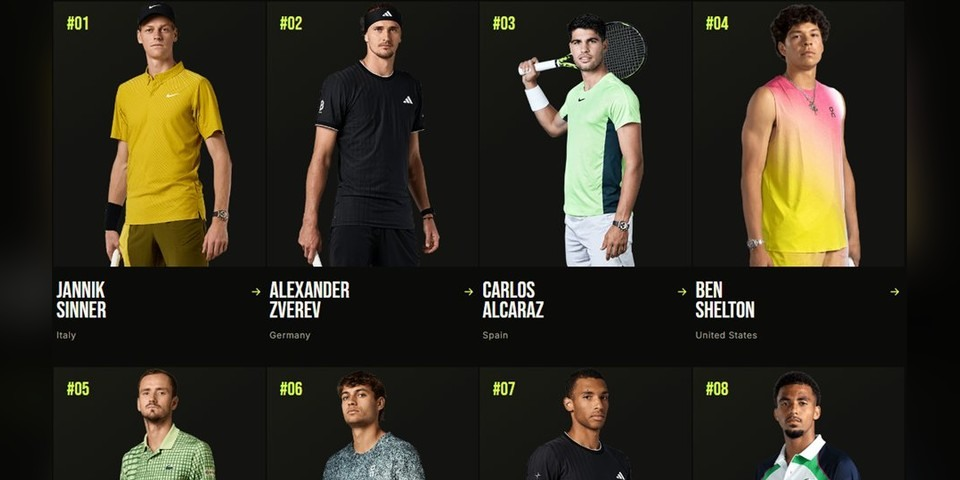</a>

**[SPORTORY](https://github.com/Jenny5789/SPORTORY)** &nbsp;Data Pipeline · Full-stack · 2026.09

`Selenium` `PostgreSQL` `FastAPI` `React` `Gemini` 

**데이터 수집 파이프라인 구축 · 웹 서비스 개발 및 배포**

- ATP 선수 기록 · Biography 웹 서비스 (Render, Vercel 배포)
- Selenium + CDP 수집 → 정제 → UPSERT, 변경분만 Gemini 번역, 작업 스케줄러 자동 수집

</td>
</tr>
<tr><td colspan="3">&nbsp;</td></tr>
<tr>
<td width="49%" valign="top">

**[HYROX 기록 분석](https://github.com/Jenny5789/hyrox-analysis)** &nbsp;Machine Learning · 2026.10

`Pandas` `scikit-learn` `Matplotlib` 

**정형 데이터 분석 · 머신러닝 모델링 및 검증**

- 대회 기록 9만 건 ML 분석: K-Means 페이스 군집, 후반 기록 회귀 · 완주 등급 분류
- 시즌 단위 분할, 데이터 누수 점검, 기준선 대비 검증

</td>
<td width="2%"></td>
<td width="49%" valign="top">

<a href="https://github.com/Jenny5789/cnn-crop-classifier">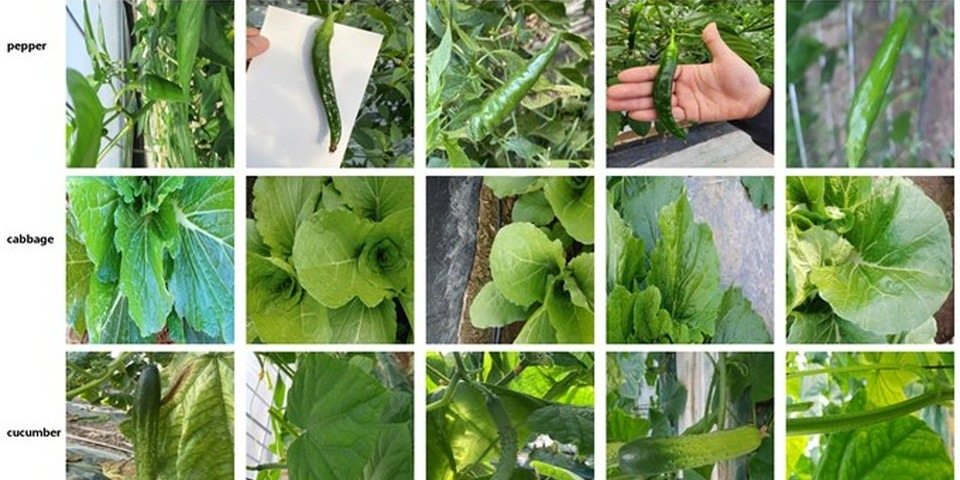</a>

**[작물 이미지 분류](https://github.com/Jenny5789/cnn-crop-classifier)** &nbsp;Deep Learning · 2026.09

`PyTorch` `torchvision` `Docker` 

**딥러닝 모델 구현 · 학습 및 성능 개선**

- 작물 3종(고추·배추·오이) 분류 CNN 설계, Test Acc 97.2%
- 언더샘플링 · 정규화 · 증강 · Early Stopping, Conv 블록 깊이 비교 실험

</td>
</tr>
<tr><td colspan="3">&nbsp;</td></tr>
</table>

<b>More Projects</b>

 

<table width="100%">
<tr>
<td width="49%" valign="top">

<a href="https://github.com/Jenny5789/CourtVision">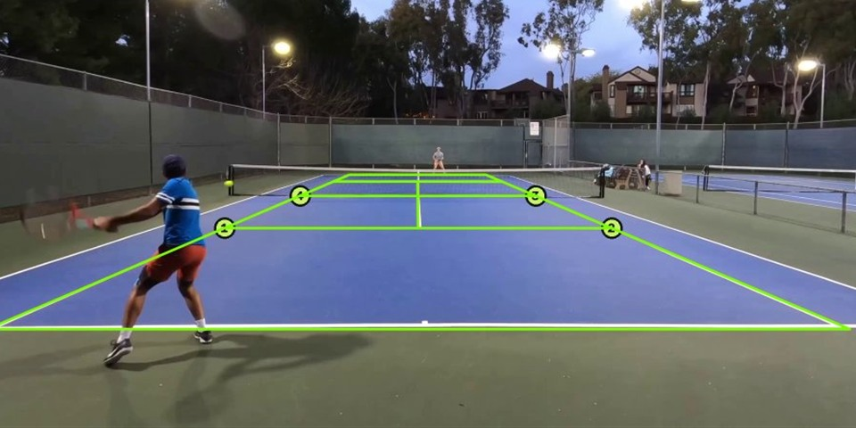</a>

**[CourtVision](https://github.com/Jenny5789/CourtVision)** &nbsp;Computer Vision · 2026.09

`YOLO11` `OpenCV` `OpenVINO` `FastAPI` 

**컴퓨터 비전 기반 영상 분석 · 모델 경량화**

- 테니스 영상 선수 추적 (YOLO11n · BoT-SORT), Homography 코트 좌표 변환
- 이동거리 · 속도 · 히트맵, INT8 양자화 (모델 68%↓ · 추론 1.7×)

</td>
<td width="2%"></td>
<td width="49%" valign="top">

<a href="https://github.com/Jenny5789/illegal-parking-detection">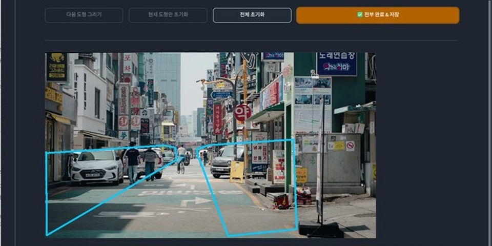</a>

**[CCTV 불법주정차 탐지](https://github.com/Jenny5789/illegal-parking-detection)** &nbsp;Object Tracking · 2026.08

`YOLOv8` `DeepSORT` `Streamlit` 

**컴퓨터 비전 기반 객체 탐지·추적 서비스 개발**

- CCTV 불법주정차 자동 탐지 웹 앱: YOLOv8 탐지 + DeepSORT 추적, ROI 기반 정차 판정
- 가림 · 카메라 흔들림 · ID 스위칭 예외 로그 진단 · 개선

</td>
</tr>
<tr><td colspan="3">&nbsp;</td></tr>
<tr>
<td width="49%" valign="top">

**[한강 수질 분석](https://github.com/Jenny5789/hangang-water-quality)** &nbsp;Data Analysis · 2026.06

`Pandas` `Plotly` `Streamlit` 

**공공 데이터 탐색적 분석 · 시각화 대시보드 구현**

- 한강 5개 측정소 36개월 수질 EDA · 시계열 분석, 등급(Ⅰ~Ⅴ) 기준 지점별 · 계절별 비교
- 하류 영양염(TN · TP) 누적, 지류(성내천) 최고 오염도 도출

</td>
<td width="2%"></td>
<td width="49%" valign="top">

<a href="https://github.com/Jenny5789/web/tree/main/korea_travel">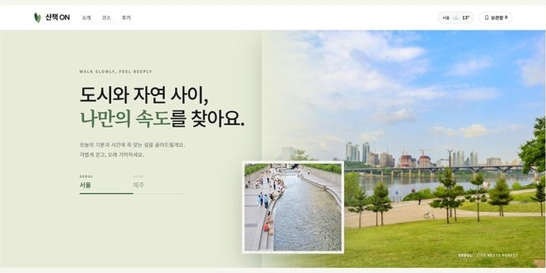</a>

**[산책 ON](https://github.com/Jenny5789/web/tree/main/korea_travel)** &nbsp;Web · Open API · 2026.06 · 3인 팀

`JavaScript` `Kakao Map API` `기상청 API` 

**Open API 연동 웹 서비스 개발**

- 서울 · 제주 산책 코스 · 맛집 조건별 추천, 기상청 단기 · 중기예보 통합 7일 예보
- 카카오맵 경로 표시, 거리 · 소요 시간 계산, 리뷰

</td>
</tr>
</table>

---

## 🧩 Mini Projects

<table width="100%">
<tr>
<td width="33%" valign="top">

<a href="https://github.com/Jenny5789/student_manager">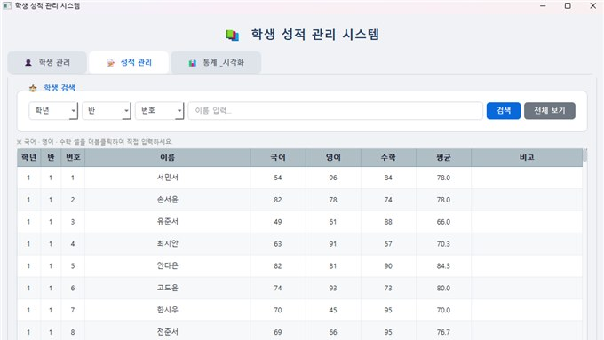</a>

**[Student Manager](https://github.com/Jenny5789/student_manager)** &nbsp;2026.06

`PyQt5` `SQLite` 

- 학생 · 성적 관리 데스크톱 앱
- 성적 일괄 저장 트랜잭션 · 롤백

</td>
<td width="33%" valign="top">

<a href="https://github.com/Jenny5789/DL_project/tree/main/flask/iris_knn_flask">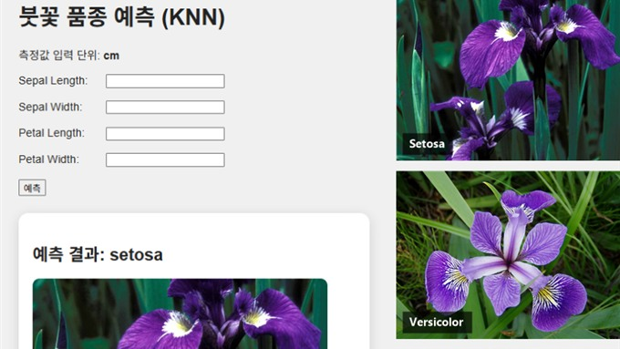</a>

**[Iris KNN 품종 분류](https://github.com/Jenny5789/DL_project/tree/main/flask/iris_knn_flask)** &nbsp;2026.10

`scikit-learn` `Flask` `Docker`

- 붓꽃 측정값 4개로 품종 3종 분류 (KNN)
- 입력값 기반 예측 · 품종별 이미지 출력

</td>
<td width="33%" valign="top">

<a href="https://github.com/Jenny5789/DL_project/tree/main/tensorflow/MNIST">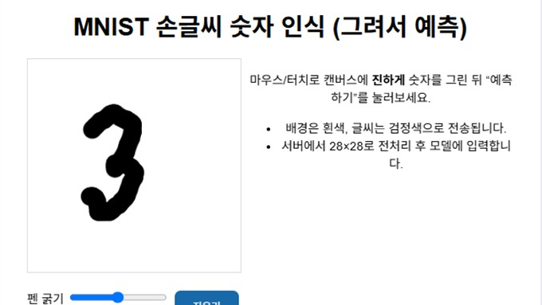</a>

**[MNIST 손글씨 숫자 인식](https://github.com/Jenny5789/DL_project/tree/main/tensorflow/MNIST)** &nbsp;2026.10

`TensorFlow` `Keras` `Flask`

- MNIST 6만 장 학습, Conv 2층 + Dense CNN 설계
- 캔버스 입력 → 28×28 전처리 → 숫자 · 확률 출력

</td>
</tr>
</table>

<b>More Mini Projects</b>

 

<table width="100%">
<tr>
<td width="33%" valign="top">

<a href="https://github.com/Jenny5789/python/tree/main/flet_projects">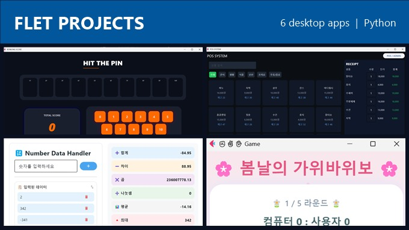</a>

**[Flet Projects](https://github.com/Jenny5789/python/tree/main/flet_projects)** &nbsp;2026.03

`Python` `Flet` `SQLite`

- 이벤트 · 상태 관리 · 클래스 · DB 연동 순서로 만든 데스크톱 앱 6종
- UP-DOWN · 가위바위보 · 연락처 · 계산기 · 볼링 점수 · POS

</td>
<td width="33%" valign="top">

**[AI Photo Studio](https://github.com/Jenny5789/photo-ai)** &nbsp;2026.05

`Flask` `Replicate API` `Render`

- 얼굴 사진 한 장으로 12가지 테마 AI 이미지 생성
- PhotoMaker API 연동(생성 완료까지 폴링), Render 배포

</td>
<td width="33%" valign="top">

<a href="https://github.com/Jenny5789/Data_Analysis_Study/tree/main/pandas/korea_air_quality_analysis">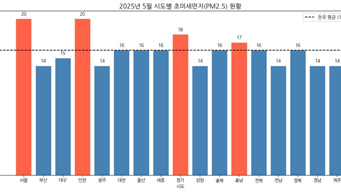</a>

**[대기오염 분석](https://github.com/Jenny5789/Data_Analysis_Study/tree/main/pandas/korea_air_quality_analysis)** &nbsp;2026.06

`pandas` `matplotlib` 

- 에어코리아 시도별 PM2.5 비교
- 엑셀 데이터 정제, 전국 평균 대비 시각화

</td>
</tr>
<tr><td colspan="3">&nbsp;</td></tr>
<tr>
<td width="33%" valign="top">

<a href="https://github.com/Jenny5789/engineering_calculator">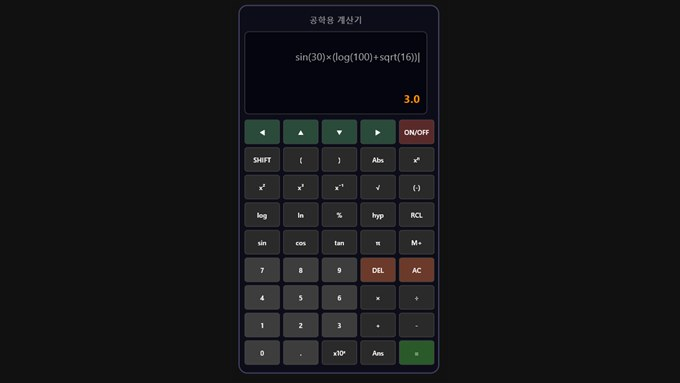</a>

**[Engineering Calculator](https://github.com/Jenny5789/engineering_calculator)** &nbsp;2026.06

`Python` `Flet` 

- 공학용 계산기
- 수식 전처리, 허용 함수 제한 eval

</td>
<td width="33%" valign="top">

**[DFS Maze](https://github.com/Jenny5789/DFS-algorithm-maze)** &nbsp;2026.06

`Python` `Flet` 

- 스택 ADT 구현
- DFS 탐색 단계별 시각화

</td>
<td width="33%" valign="top">

**[Card Quiz](https://github.com/Jenny5789/card_quiz)** &nbsp;2026.06

`Flutter` `Dart` 

- 플래시카드 단어장 학습 앱
- 줄 편집기 CRUD 응용, 오답 복습

</td>
</tr>
<tr><td colspan="3">&nbsp;</td></tr>
<tr>
<td width="33%" valign="top">

**[To-Do List](https://github.com/Jenny5789/todo_list)** &nbsp;2026.06

`JavaScript` `localStorage` 

- 그룹형 할 일 · 메모 관리 웹 앱
- localStorage 영속화, 상태 필터

</td>
<td width="33%" valign="top">

<a href="https://github.com/Jenny5789/promptframe-studio">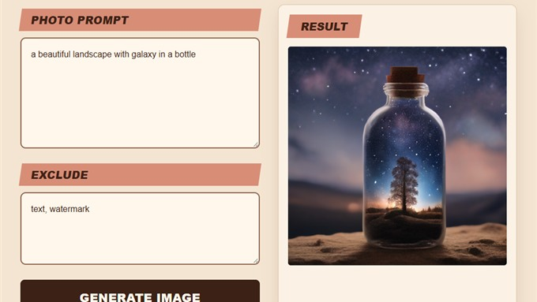</a>

**[Prompt Frame Studio](https://github.com/Jenny5789/promptframe-studio)** &nbsp;2026.11

`Flask` `Docker` `ComfyUI`

- 프롬프트 입력 기반 이미지 생성 웹 앱 (Flux 2)
- Flask 컨테이너 ↔ ComfyUI 서버 API 연동

</td>
</tr>
</table>

---

## 📚 Study

<table width="100%">
<tr><td colspan="2"></td></tr>
<tr>
<td width="50%" valign="top">
&nbsp;&nbsp;<b><a href="https://github.com/Jenny5789/python">Python</a></b> 
이론 노트 · 자료구조 구현 · 코딩테스트
</td>
<td width="50%" valign="top">
&nbsp;&nbsp;<b><a href="https://github.com/Jenny5789/Data_Analysis_Study">Data Analysis</a></b> 
NumPy · Pandas 공식 문서 기반 실습
</td>
</tr>
<tr>
<td width="50%" valign="top">
&nbsp;&nbsp;<b><a href="https://github.com/Jenny5789/DL_project">Deep Learning</a></b> 
딥러닝 · 머신러닝 이론 · Flask · Docker 실습
</td>
<td width="50%" valign="top">
&nbsp;&nbsp;<b><a href="https://github.com/Jenny5789/computer-vision-basics">Computer Vision</a></b> 
OpenCV 특징점 매칭 · 객체 인식
</td>
</tr>
<tr>
<td width="50%" valign="top">
&nbsp;&nbsp;<b><a href="https://github.com/Jenny5789/web">Web</a></b> 
HTML · CSS · JavaScript 실습
</td>
<td width="50%" valign="top">
&nbsp;&nbsp;<b><a href="https://github.com/Jenny5789/java">Java</a></b> 
기초 문법 · 클래스와 객체 · 서블릿
</td>
</tr>
<tr>
<td width="50%" valign="top">
&nbsp;&nbsp;<b><a href="https://github.com/Jenny5789/cpp-study">C++</a></b> 
C++ 기초 문법 · 연습문제
</td>
<td width="50%" valign="top">
&nbsp;&nbsp;<b><a href="https://github.com/Jenny5789/Total-TIL/tree/main/Linux">Linux</a></b> 
Linux 기본 명령어 · VI 에디터 실습
</td>
</tr>
</table>
